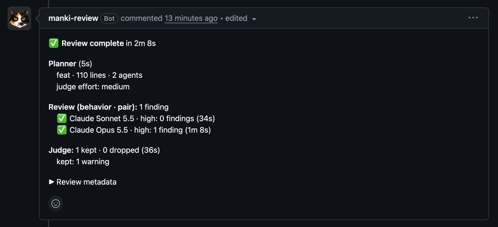
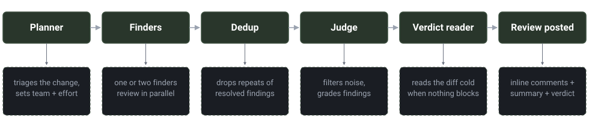

<p align="center">
  
</p>

<h1 align="center">Manki — curious, thorough, and always learning</h1>

<p align="center">
  <a href="https://github.com/manki-review/manki/actions/workflows/ci.yml"></a>
  <a href="https://codecov.io/gh/manki-review/manki"></a>
</p>

<p align="center"><strong>Your tokens, your rules.</strong> Self-hosted AI code review that runs on your own GitHub runners and learns from your team.</p>

Manki sizes each review to the nature of the change, and you decide who reviews what. By default a change where no defect could hide gets one quick check, and one that could reach your users gets two finders on different models. In `.manki.yml` you can set up your own review groups, each reader with its own model, effort and focus, and route kinds of changes to them. Dedup drops repeats from prior reviews, a judge filters noise and classifies what remains, and manki learns your team's conventions over time.

<p align="center">
  
</p>

## Why Manki

- **Multi-stage pipeline**: a planner triages the change, finders review in parallel, dedup catches repeats from prior reviews, a judge filters noise and classifies findings by severity
- **You decide who reviews what**: a review group lists the readers for a kind of change, each with its own model, effort and focus, and you route changes to groups by path or by the planner's triage. By default a change that could reach a user gets a second finder on another model with the same checklist, so the two models miss different things
- **Smart verdicts**: blocks PRs on real issues, holds the approval while a warning waits for a fix or an accepted answer, approves over optional suggestions, and auto-approves once the last blocking or warning thread clears
- **Multi-provider**: Anthropic, OpenAI, and Gemini, mix-and-match per stage and per reader via `.manki.yml`
- **Self-learning memory**: `/manki remember` teaches conventions, `/manki dismiss` suppresses false positives, patterns stick across PRs
- **Conversational**: reply to any review comment to discuss, or use `/manki explain`/`forget` inline
- **Self-hosted GitHub Action**: your API key, your compute. The Manki service only puts the events in order and starts the runs

## Quick start

1. **Install the app**: [github.com/apps/manki-review](https://github.com/apps/manki-review). The Manki service serves only the accounts it lists, so ask the maintainers to add yours
2. **Add a provider secret**: `ANTHROPIC_API_KEY`, `OPENAI_API_KEY`, or `GEMINI_API_KEY` (OAuth subscription paths are also supported, see [Getting started](docs/getting-started.md#choosing-a-provider))
3. **Add the workflow**: copy the YAML from [Getting started](docs/getting-started.md#step-3-add-the-workflow)

Full setup guide with troubleshooting: **[Getting started](docs/getting-started.md)**. Coming from v6? See [Migrating to v7](docs/migrating-to-v7.md). More in [How reviews work](docs/how-reviews-work.md), [Configuration](docs/configuration.md), [Review memory](docs/memory.md) and the [Security model](docs/security.md).

## How it works

Manki wakes up when a PR is opened. A fast planner (Haiku) triages the change and sets the effort, the finders of its review group review it in parallel (one or two by default), dedup drops findings that match repeats from prior reviews, and the judge evaluates and classifies what remains. When nothing blocks, a verdict reader reads the whole diff cold before Manki approves. Results land as inline comments plus a summary and verdict. A finding shows what goes wrong, with everything else in one collapsed section: how to fix it, why it matters, and how it was checked. Its summary names those parts, counts the places read and, for a blocker or a warning, says how it was checked: proven from the cited lines, confirmed with tools or not confirmed. Inside, up to three places show as GitHub code previews, each under the sentence its check gives, and the rest are linked. A finding that cites nothing says so. A blocker requests changes. A warning holds the approval until it is fixed, or until the PR author or a maintainer dismisses it with a reason in its thread. A security warning, or a warning a check lowered from a blocker, needs a fix or a maintainer's resolve. Every warning in the PR's own code gets a thread, also one Manki finds late on lines it reviewed before, so a late warning can take back an approval. When all blocking threads resolve and every warning thread is answered, manki approves.

<p align="center">
  
</p>

See [How reviews work](docs/how-reviews-work.md#review-pipeline) for the full walkthrough.

One or two finders is only the default. The `review` block in `.manki.yml` sets who reviews what. This example sends changes to security-sensitive and data contract paths to two strong readers on two providers, and reviews everything else as the defaults do:

```yaml
review:
  groups:
    trivial: [claude-sonnet-5-5]                  # the quick check of a trivial change
    solo: [claude-sonnet-5-5]                     # a low-risk change, one finder
    full: [claude-sonnet-5-5, claude-opus-5-5]    # everything else
    deep:                                         # a group of your own
      - { model: claude-opus-5-5, effort: high, focus: "authz, injection, secret handling" }
      - { model: gpt-5.5, effort: high }
  routing:
    security: deep
    data_contract: deep
```

Changes to security-sensitive paths, CI or dependency files and data contracts always get at least two finders on two distinct models. See [Review groups](docs/how-reviews-work.md#review-groups) for groups, classes and routing.

## Talk to Manki

| Command | What it does |
|---------|-------------|
| `/manki review` | Review the head commit, unless Manki's newest review of it is complete. A request for changes that a person dismissed still counts as that review. Then Manki replies that no round started, with a Review again box that reviews the commit again, runs the approval check as resolving a thread does, and the settings block shows it as up to date |
| `/manki explain [topic]` | Ask about the PR changes |
| `/manki dismiss [finding]` | Dismiss a finding. In a Manki finding's thread it resolves the thread, or says in the thread why it stays open or keeps blocking. A dismissal never lifts a warning's hold on the approval, and the reply says what does. A named finding is stored as a suppression in memory when its text matches a finding Manki posted on the PR. In a PR comment, a name that matches a warning the last review listed only in its body, or carried there, ends that warning on this PR without a suppression, for someone with write access. Without either, Manki replies with how to use it |
| `/manki remember <instruction>` | Teach it something for future reviews |
| `/manki remember global: <instruction>` | Stores nothing. Global learnings apply to every repo sharing the memory, so the owner of the memory repo edits `_global/` by hand |
| `/manki check` | Check thread resolution and auto-approve if clear |
| `/manki forget <text>` | Remove a learning matching the text |
| `/manki forget suppression <pattern>` | Remove a suppression matching the pattern |
| `/manki allow @<login>` | Let an account without write access use Manki in this repository. Needs the `maintain` or `admin` role |
| `/manki disallow @<login>` | Take that back. Needs the `maintain` or `admin` role |
| `/manki allowed` | List the accounts allowed to use Manki here, with who allowed each one and when |
| `/manki help` | Show all commands |

A message from Manki that names one of these steps carries a box for it, such as Review again, Check approval, Forget this learning or Dismiss this finding. Ticking the box does what the command does, for the same people. See [Severity tiers](docs/how-reviews-work.md#severity-tiers).

Always write `/manki`. A command that mentions `@manki` still works, but it notifies an unrelated GitHub user, so Manki's answer asks for `/manki` next time. A reply in one of Manki's review threads needs no prefix. It gets one short answer that starts with Fixed, Withdrawn, Agreed, Kept or Unverified, or with a bold line on what happens to the thread when that word alone would not tell, such as "Not settled yet". With the Claude or Codex CLI, Manki checks the reply against the PR head with the same read-only tools its reviewers use. It answers Fixed only when it cites a line the PR changed since the finding was posted, or since a review last found it still open, Withdrawn only when the code proves the finding wrong, Agreed when you defer the finding to later work, Kept only with new lines that show the problem still happens, and Unverified when the reply rests on facts it can't check from the code or the PR description, so a maintainer should confirm them and resolve the thread if it is open. When a review that finished after your reply already confirmed the fix, the answer may point to that review instead. A reply that says another pull request fixes a blocker or a security finding gets Confirmed only when that pull request, merged into the default branch, replaced the cited line, and Unverified with the reason otherwise. Neither clears the thread, since the fix is not in this PR's code yet: once that pull request is merged, update this branch, and the next review sees the fix. See [a fix in another pull request](docs/how-reviews-work.md#a-fix-in-another-pull-request). Below its answer Manki lists up to 5 statements your reply makes about code or about the PR description, each with what it checked: a line cited for or against it that exists, a text no line holds, a text the PR description holds or does not hold, or not checked and why. A listed line says what was checked, not that the statement is right. It also checks them in the [related repositories](docs/how-reviews-work.md#related-repositories). The list clears nothing: a Withdrawn needs a line of the PR's own repository, and a blocker still needs a maintainer. See [replies in a review thread](docs/how-reviews-work.md#replies-in-a-review-thread). For Fixed, Withdrawn and Agreed, Manki resolves the thread when the PR author or a collaborator wrote the reply. A blocker or a security finding is resolved only for a collaborator other than the PR author. On a warning thread, only one of those three answers to the PR author or a collaborator lifts the hold on the approval. Kept and Unverified leave it in place, and the answer says what lifts it: a fix, a tick of the thread's `Create an issue for this` box, or a resolve by someone with the role `author_clear_role` names. When a collaborator's reply gets a finding withdrawn and memory is on, Manki saves a learning for that file once the thread is cleared, and adds to its answer how to remove it with `/manki forget`. A thread that stays open leaves no learning, as a blocker does on a reply from the PR author. A security finding never leaves a learning. Once Manki has answered a thread, a later review that finds the same problem again never opens a new thread for it, unless it now grades the problem above that thread. It replies in that thread only when the code there got worse, and reopens the thread when it was closed. The next review bodies list the warnings and blockers Manki agreed to leave for later under a "follow-ups" heading. When Manki cannot answer a reply, a question, `explain` or `check`, it says so where you wrote it, with the reason, and the run fails. A reply that got no answer changes no thread and approves nothing. Reply or comment again to start a new try. Tip: edit a PR comment to add `/manki` if you forgot to include it. An edited reply in a review thread is not read again.

On a merged or closed PR Manki still answers, but changes nothing about the review: `review` reviews nothing and offers a Review anyway box, a reply or `dismiss` resolves and stores nothing, and `check` approves nothing. See [how reviews work](docs/how-reviews-work.md#severity-tiers).

## Review locally

`manki review` runs the same review on your branch before you push: the planner, the finders, dedup, the judge and the verdict reader. It reviews the change from the merge base with the base branch to `HEAD`, as the pull request would show it, reads `.manki.yml` and the instruction files from the base, and writes nothing to GitHub. Memory, earlier rounds and CI results stay out, since they live on GitHub.

```sh
export CLAUDE_CODE_OAUTH_TOKEN=...      # or any key the Action takes, as an environment variable
npx github:manki-review/manki#v7 review               # current branch against the remote's default branch
npx github:manki-review/manki#v7 review main..topic   # a range
npx github:manki-review/manki#v7 review --json --record round.json
```

The findings print as Markdown, or as JSON with `--json`. The JSON has `approvalHeld` next to `verdict`: the reason a pull request round would hold its approval and post a comment instead, such as `warnings`, `unread` or `config`, or `false` when nothing holds. As in the action's output, `verdict` is `APPROVE` only when nothing holds, `REQUEST_CHANGES` when something blocks, and `COMMENT` otherwise. `--record` writes the round record a pull request round would post. The exit code is 0 when a pull request round would approve, 1 when something blocks, a warning would hold the approval (an earlier round's warning thread that is still open included), a changed file no model reads would hold it, the base config did not load or the change breaks it, and 2 when the review is incomplete or failed. Run `manki review --help` for every option.

## Configure

Create `.manki.yml` in your repo root. Manki reads its config from this one file on the base branch:

```yaml
auto_review: true
auto_approve: true
exclude_paths: ["Cargo.lock", "vendor/**"]

instructions: |
  This is a Rust project. Focus on ownership and error handling.

models:
  planner: claude-haiku-5-5
  judge: claude-opus-5-5
  dedup: claude-haiku-5-5

review:
  groups:                                         # who reviews
    trivial: [claude-sonnet-5-5]
    solo: [claude-sonnet-5-5]
    full: [claude-sonnet-5-5, claude-opus-5-5]
```

See [`.manki.yml.example`](.manki.yml.example) for all options, or [Configuration](docs/configuration.md) for the full guide.

## Security

Secrets are masked, PR content is sanitized before posting, and only people with write access to the repo, or accounts a maintainer [allowed](docs/getting-started.md#allowing-an-account-without-write-access), can start Manki from a comment or change its memory. See the [Security model](docs/security.md).

## License

AGPL-3.0
