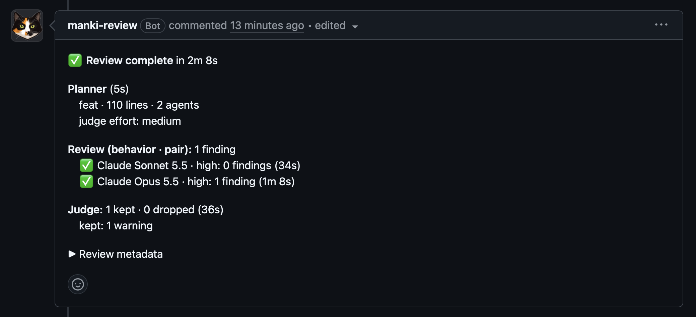
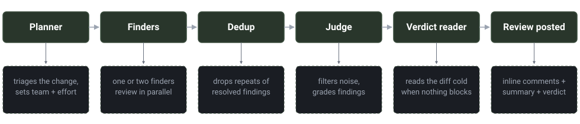

<p align="center">
  
</p>

<h1 align="center">Manki — curious, thorough, and always learning</h1>

<p align="center">
  <a href="https://github.com/manki-review/manki/actions/workflows/ci.yml"></a>
  <a href="https://codecov.io/gh/manki-review/manki"></a>
</p>

<p align="center"><strong>Your tokens, your rules.</strong> Self-hosted AI code review that runs on your own GitHub runners and learns from your team.</p>

Manki sizes each review to the nature of the change: one reader for a change where no defect could hide, two readers on different models for one that could reach your users. Dedup drops repeats from prior reviews, a judge filters noise and classifies what remains, and manki learns your team's conventions over time.

<p align="center">
  
</p>

## Why Manki

- **Multi-stage pipeline** — a planner triages the change, finders review in parallel, dedup catches repeats from prior reviews, a judge filters noise and classifies findings by severity
- **Two models where it matters** — changes that could reach a user get a second finder on another model with the same prompt, so the two readers miss different things
- **Smart verdicts** — blocks PRs on real issues, approves over style nitpicks; auto-approves when all blocking threads resolve
- **Multi-provider** — Anthropic, OpenAI, and Gemini, mix-and-match per stage via `.manki.yml`
- **Self-learning memory** — `/manki remember` teaches conventions, `/manki dismiss` suppresses false positives, patterns stick across PRs
- **Conversational** — reply to any review comment to discuss, or use `@manki explain`/`forget` inline
- **Self-hosted GitHub Action** — your API key, your compute, no SaaS intermediary

## Quick start

1. **Install the app** — [github.com/apps/manki-review](https://github.com/apps/manki-review)
2. **Add a provider secret** — `ANTHROPIC_API_KEY`, `OPENAI_API_KEY`, or `GEMINI_API_KEY` (OAuth subscription paths are also supported, see [SETUP.md](SETUP.md#choosing-a-provider))
3. **Add the workflow** — copy the YAML from the [Setup Guide](SETUP.md#step-3-add-the-workflow)

Full setup guide with memory and troubleshooting: **[SETUP.md](SETUP.md)**

## How it works

Manki wakes up when a PR is opened. A fast planner (Haiku) triages the change and sets the effort, one or two finders review it in parallel, dedup drops findings that match repeats from prior reviews, and the judge evaluates and classifies what remains. Results land as inline comments plus a summary and verdict. When all blocking threads resolve, manki approves.

<p align="center">
  
</p>

See [SETUP.md](SETUP.md#review-pipeline) for the full walkthrough.

## Talk to Manki

| Command | What it does |
|---------|-------------|
| `/manki review` | Review the head commit, unless Manki already has a complete review of it. Then Manki replies with a Force review box, and ticking it reviews the commit again |
| `/manki explain [topic]` | Ask about the PR changes |
| `/manki dismiss [finding]` | Dismiss a finding (stored as suppression in memory). In a Manki thread, it also resolves the thread |
| `/manki remember <instruction>` | Teach it something for future reviews |
| `/manki remember global: <instruction>` | Teach globally (applies to all repos) |
| `/manki check` | Check thread resolution and auto-approve if clear |
| `/manki forget <text>` | Remove a learning matching the text |
| `/manki forget suppression <pattern>` | Remove a suppression matching the pattern |
| `/manki help` | Show all commands |

You can also use `@manki` as the command prefix. A reply to a review comment gets one short answer that starts with Fixed, Agreed, Withdrawn or Still open. For the first three, Manki resolves the thread when the PR author or a collaborator wrote the reply. Tip: edit a comment to add `/manki` if you forgot to include it.

## Configure

Create `.manki.yml` in your repo root:

```yaml
auto_review: true
auto_approve: true
exclude_paths: ["*.lock"]

instructions: |
  This is a Rust project. Focus on ownership and error handling.

models:
  planner: claude-haiku-5-5
  reviewer: claude-sonnet-5-5
  reviewer_pair: claude-opus-5-5   # second finder on paired rounds
  judge: claude-opus-5-5
  dedup: claude-haiku-5-5
```

See [`.manki.yml.example`](.manki.yml.example) for all options, or [SETUP.md](SETUP.md) for the full guide.

## Security

Secrets are masked, PR content is sanitized before posting, and memory access is restricted to repo collaborators. See [SETUP.md](SETUP.md#security) for the full security model.

## License

AGPL-3.0
